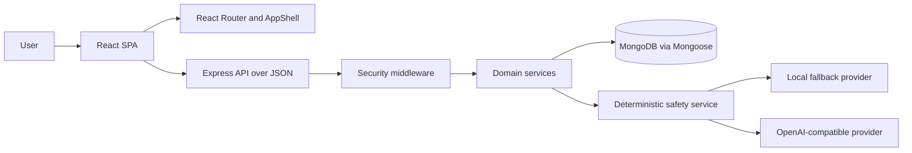

# AuraWell AI: Project Overview and Presentation Content

## 1. Executive Summary

AuraWell AI is a full-stack, AI-assisted mental wellness and daily reflection platform. It brings structured self-assessments, mood and lifestyle tracking, guided journaling, habits, ambient soundscapes, reflective games, analytics, recommendations, and a conversational companion into one application.

The product is designed for wellness reflection and education. It is not a medical device and does not diagnose, treat, or cure a condition. Its most important design principles are:

- **Non-diagnostic reflection:** deterministic rules produce explainable indicators and suggestions instead of clinical diagnoses.
- **Safety before AI:** crisis and medical-advice messages are screened by server-side deterministic logic before an external model can be called.
- **Consent-first AI:** external AI use requires explicit user consent; without consent, the local deterministic fallback remains available.
- **Age adaptation:** content is tailored for children, teens, adults, and older adults; children do not reach an external language model.
- **Privacy by default:** user-scoped data, session authentication, data export, soft account deletion, and consent records are built into the platform.

## 2. Problem and Proposed Solution

### Problem

Digital wellness tools are often fragmented across separate mood, sleep, journal, habit, music, and chat applications. Some products also blur the boundary between wellness reflection and clinical diagnosis, while unconstrained AI can provide unsafe medical or crisis responses. Sensitive personal reflections may also be shared with external services without clear consent.

### Solution

AuraWell AI provides one guided experience in which a user can:

1. Complete a short or detailed wellness reflection.
2. Receive transparent indicators, recommendations, and a seven-day action plan.
3. Record mood, sleep, activity, journals, and habits over time.
4. Use calming soundscapes and reflective mini-games.
5. Talk to AURA within explicit safety, privacy, and consent boundaries.
6. Review trends and manage personal data from analytics and privacy screens.

## 3. Main Features: Technology and Purpose

| Feature | What it provides | Main technologies | Purpose |
| --- | --- | --- | --- |
| Authentication and onboarding | Registration, login, logout, password reset, age group, consent, goals, preferences | React, React Router, Zustand, Express, `express-session`, MongoDB, Mongoose, bcryptjs, Zod | Establish a personalized and protected user experience |
| Assessment catalogue | Age-appropriate assessments with quick, standard, and detailed modes | React components, TypeScript, Express routes, Mongoose models, static assessment data | Make self-reflection practical at different time commitments |
| Deterministic assessment engine | Validates answers, applies conditional questions, calculates tags/weights/indicators, and matches interpretation rules | TypeScript domain service | Provide explainable, repeatable, non-diagnostic results |
| Recommendations and action plans | Suggestions for activities, games, habits, journal prompts, reflections, breathing, and soundscapes, plus a seven-day plan | TypeScript services, MongoDB, age eligibility rules | Turn reflection into small, actionable next steps |
| Mood tracker | Mood entries, daily history, and trends | React, API service layer, Express, Mongoose | Help users notice emotional patterns without labeling them clinically |
| Journal | Prompts, searchable entries, editing, and soft deletion | React, TypeScript, Express, Mongoose | Support private written reflection |
| Sleep tracker | Sleep records, duration validation, summaries, and trends | React, Express, Mongoose, server validation | Help users reflect on rest and routine |
| Activity tracker | Activity logging and summaries | React, Express, Mongoose | Encourage awareness of movement and daily activity |
| Habits and goals | Habit creation, daily completion, progress, archiving, and onboarding goals | React, Zustand where appropriate, Express, Mongoose | Support sustainable routines through low-pressure repetition |
| MindPlay games | Age-filtered games, sessions, scores, statistics, and server-authoritative XP | React, TypeScript, Express, Mongoose | Add short, reflective activities without public leaderboards |
| Ambient music | Persistent playback, queue, volume, seek, shuffle, loop, and expanded player | HTML5 audio, local audio assets, Zustand, Motion, Tailwind CSS | Provide a calming background while users reflect or journal |
| AURA counseling | Conversation sessions, messages, closing/deleting sessions, and AI status | Express, TypeScript, MongoDB, pluggable chat provider interface | Offer a reflective conversational companion, not a therapist |
| Safety gate | Crisis support and medical-boundary responses before model access | Deterministic TypeScript pattern matching and canned responses | Make high-risk behavior predictable, testable, and independent of an LLM |
| AI fallback | Offline deterministic reflective replies when consent, configuration, or upstream availability is missing | Local TypeScript fallback provider | Preserve a usable response without sending data externally |
| Analytics | Aggregated totals, latest check-in, and mood/sleep/activity trend series | Express services, MongoDB aggregation/query logic, React charts | Help users understand progress over time |
| Notifications | Preference-aware in-app notifications, read states, and deletion | Express, Mongoose, React | Surface useful reminders and updates without requiring email |
| Privacy controls | Consent overview, data counts, full JSON export, and soft account deletion | Express, Mongoose, session destruction, React | Give users visibility and control over stored wellness data |

## 4. Assessment Workflow

1. The authenticated client requests the assessment catalogue for the user's age group.
2. The server returns a runnable assessment without exposing scoring tags or internal weights.
3. The client presents the selected depth mode and interactive question controls.
4. Conditional questions are shown only when their dependency answers match.
5. The server validates question IDs, response types, required answers, ranges, and selections.
6. The deterministic engine maps answers to tags and weighted indicators.
7. Interpretation rules produce a summary, priorities, suggestions, and a seven-day plan.
8. Suggestions are enriched from the wellness catalogue, filtered by age eligibility, and persisted as recommendations.
9. The result is stored with a clear non-diagnostic disclaimer and can be viewed later.

The documented question bank covers 15 reflection areas, including mood, stress, anxiety and worry, sleep, emotional wellbeing, self-esteem, burnout, focus, social connection, motivation, anger, resilience, gratitude, lifestyle/digital wellbeing, and weekly reflection. The repository documentation describes an inventory of 540 questions.

## 5. AURA Safety and AI Workflow

Every counseling message follows this order:

1. **Deterministic safety screen:** crisis and medical-boundary patterns are checked first.
2. **Crisis response:** the system returns a human-written response and crisis resources; no model call is made.
3. **Medical-boundary response:** the system declines diagnosis, prescription, dosage, or medication advice and recommends a qualified professional.
4. **Child protection:** child accounts receive curated activities and do not reach an external model.
5. **Consent check:** external wellness data is sent to a provider only when AI data consent is enabled.
6. **Provider selection:** a configured OpenAI-compatible provider may answer for eligible, consented users.
7. **Fallback:** missing configuration, timeout, non-success response, empty content, or provider failure uses the deterministic local fallback.

This architecture keeps safety and privacy decisions in application code rather than relying only on a prompt or model behavior. The browser never receives an AI provider key.

## 6. System Architecture



### Client

The client is a Vite-powered React single-page application. `AppRoutes` handles public pages, onboarding, authenticated routes, session-expiry redirection, theme preferences, and the protected `AppShell`. Feature folders keep assessment, counseling, music, wellness, games, analytics, and privacy behavior close to their UI and service code.

### Server

The server is an Express API organized into routes, controllers, services, models, middleware, validators, AI providers, static content, and scripts. Controllers shape HTTP requests and responses; domain services own business rules and model access; Mongoose models define persistence and DTO transformations.

### Request lifecycle

1. Helmet, CORS, body limits, and cookie parsing are applied.
2. Session middleware loads the server-side session from MongoDB.
3. API rate limiting and double-submit CSRF protection run.
4. Routes apply authentication and Zod validation.
5. Controllers call domain services.
6. Services query user-scoped models and return DTOs.
7. Central error handling returns a consistent error envelope.

## 7. Technology Stack and Why It Is Used

### Frontend

| Technology | Purpose |
| --- | --- |
| React 19 and React DOM | Component-based, reactive user interface |
| TypeScript 5.9 | Static typing across UI, services, and domain contracts |
| Vite 8 | Fast development server and production bundling |
| React Router DOM 7 | Client-side routing and protected navigation |
| Tailwind CSS 4 and Tailwind Vite plugin | Utility styling and design tokens |
| Motion 14 | Page transitions and purposeful interaction animation |
| Zustand 5 | Lightweight global state for authentication, music, theme, and related UI state |
| React Hook Form and Zod | Form state and client-side schema validation |
| Base UI, class-variance-authority, clsx, tailwind-merge | Accessible primitives and consistent conditional styling |
| Lucide React | Interface icons |

### Backend

| Technology | Purpose |
| --- | --- |
| Node.js and TypeScript | Server runtime and typed application code |
| Express 5 | HTTP API, routing, middleware, and controllers |
| MongoDB and Mongoose 9 | Document persistence, schemas, queries, and DTO mapping |
| Zod 4 | Runtime validation for request bodies, parameters, and configuration |
| `express-session` and `connect-mongo` | Server-side session authentication with MongoDB persistence |
| bcryptjs | Password hashing and verification |
| Helmet and CORS | Security headers and controlled cross-origin access |
| express-rate-limit | API and authentication abuse limits |
| cookie-parser | Cookie handling for sessions and CSRF |
| Pino and pino-http | Structured server and request logging |

### Testing and tooling

| Technology | Purpose |
| --- | --- |
| Vitest | Unit and integration test runner for client and server |
| Testing Library and jsdom | User-oriented React component testing |
| Supertest | HTTP API and route testing |
| MongoDB Memory Server | Isolated database tests without requiring a persistent test database |
| Playwright | End-to-end smoke testing |
| ESLint, Prettier, TypeScript compiler | Code quality, formatting, and static verification |
| npm workspaces and concurrently | Monorepo dependency management and parallel development servers |

## 8. Security, Privacy, and Ethics

- Passwords are hashed; password hashes and reset secrets are removed from public DTOs.
- Sessions use an HttpOnly, SameSite cookie and a MongoDB-backed session store.
- Unsafe requests require a CSRF token header matching the CSRF cookie.
- Helmet, CORS allow-listing, body-size limits, and rate limiting reduce common web risks.
- Every user-owned query is scoped by `userId`; missing foreign resources resolve as not found.
- AI provider calls happen only on the server and only after consent and safety checks.
- Children are prevented from reaching external language models.
- Users can inspect consent/data summaries, export their stored data, and soft-delete an account.
- The product uses wellness language and clearly states that it is not diagnostic or emergency care.

## 9. Presentation-Ready PPT Outline

### Slide 1: Title

**AuraWell AI: AI-Assisted Mental Wellness and Daily Reflection**

Key message: one private platform for reflection, routines, calming audio, and bounded conversational support.

### Slide 2: Problem

- Wellness tools are fragmented.
- Users can be exposed to diagnostic overreach and unsafe AI advice.
- Sensitive reflections require stronger consent and privacy controls.

### Slide 3: Proposed Solution

- Unified dashboard for assessment, tracking, music, games, recommendations, analytics, and AURA.
- Non-diagnostic language and explainable scoring.
- Safety and privacy enforced in server-side code.

### Slide 4: Users and Age Adaptation

- Children, teens, adults, and older adults receive age-appropriate content.
- Wording, eligibility, navigation, and AI access adapt to the age group.
- Children receive curated activities rather than external model responses.

### Slide 5: Assessment Engine

- 15 reflection areas and a documented 540-question inventory.
- Quick, standard, and detailed check-in modes.
- Conditional questions, multiple response types, deterministic scoring, indicators, and history.

### Slide 6: Recommendations and Action Plans

- Assessment results become age-eligible suggestions.
- Activities, habits, journal prompts, breathing, games, and soundscapes are supported.
- Every result can produce a structured seven-day plan.

### Slide 7: Ambient Soundscape Player

- Persistent playback across authenticated pages.
- Local audio assets and global Zustand state.
- Playback controls and assessment-linked soundscape recommendations.

### Slide 8: Wellness Trackers

- Mood, sleep, activity, journal, habits, and goals.
- Daily entries, summaries, trends, and progress signals.
- Designed for low-friction reflection rather than clinical measurement.

### Slide 9: AURA Companion

- Session-based reflective conversations.
- Safety gate before any model call.
- Consent-controlled provider access and deterministic fallback.

### Slide 10: Security and Privacy

- Session authentication, CSRF, rate limits, validation, security headers, and user scoping.
- Export and soft deletion.
- No provider key in the browser and no model access for child accounts.

### Slide 11: Architecture

- React/Vite client communicates with Express/TypeScript API.
- Controllers call domain services, which use Mongoose models and MongoDB.
- AI provider abstraction isolates external model behavior from the rest of the system.

### Slide 12: Technology Stack

- React 19, TypeScript, Vite 8, Tailwind CSS 4, Motion, Zustand, and React Router 7.
- Node.js, Express 5, MongoDB, Mongoose 9, Zod 4, sessions, Helmet, and rate limiting.
- Vitest, Testing Library, Supertest, Playwright, ESLint, and Prettier.

### Slide 13: Quality Assurance

- Client and server test suites cover UI behavior, domain logic, API routes, authentication, AI safety, privacy, recommendations, games, and wellness flows.
- Typechecking, linting, production builds, and Playwright smoke tests provide layered verification.
- Use current command output for exact pass counts in the final presentation.

### Slide 14: Current Scope and Future Enhancements

Current scope includes the implemented features and safeguards described in this document. Potential future work should be presented separately from current functionality, for example guardian verification, offline/PWA support, richer audio mixing, health-device integrations, or local small language models.

### Slide 15: Conclusion

AuraWell AI demonstrates how a wellness application can combine a rich user experience with deterministic safety, consent-aware AI, privacy controls, and explainable domain logic.

## 10. Run and Verify the Project

Prerequisites: Node.js 20+ and MongoDB.

```bash
npm install
cp .env.example .env
npm run dev
```

Useful verification commands:

```bash
npm run typecheck
npm run lint
npm test
npm run build
npm run test:e2e
```

The client normally runs at `http://localhost:5173` and the API at `http://localhost:4000`.

## 11. Related Documentation

- [Architecture](architecture.md): component boundaries, request lifecycle, and service design.
- [API reference](api.md): routes, payloads, authentication, and response envelopes.
- [Security](security.md): threat model, sessions, CSRF, validation, privacy, and AI controls.
- [Privacy and ethics](privacy-ethics.md): consent and non-diagnostic policy.
- [Presentation deck source](presentation-deck.md): the earlier detailed slide script.