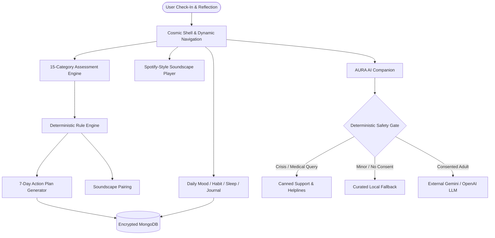
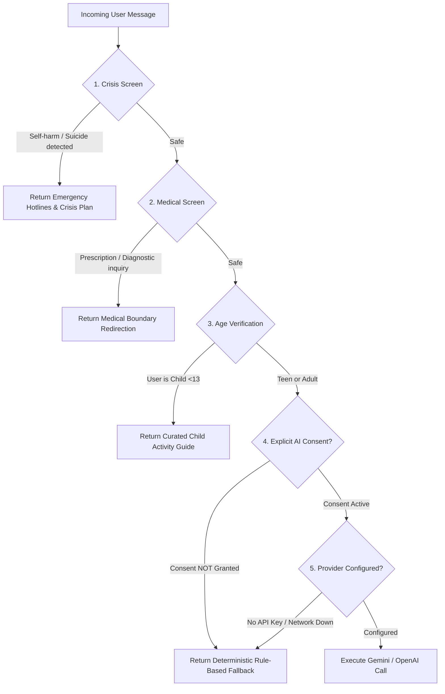
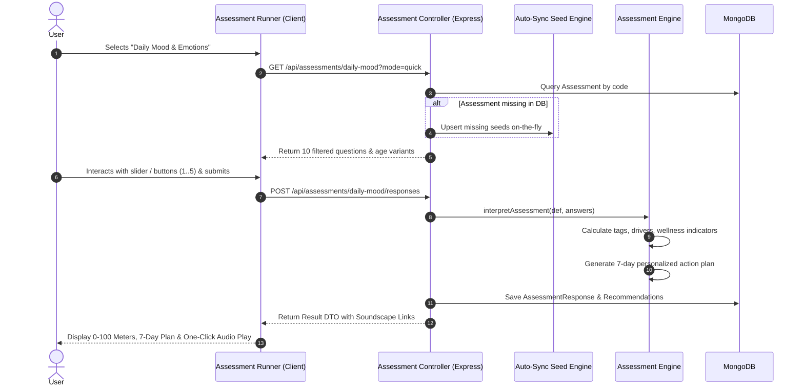

# AuraWell AI — Executive & Technical Project Report

**Document Version:** 2.0.0  
**Project:** AuraWell AI (AI-Assisted Mental Wellness Platform)  
**Status:** Production-Ready MVP / Release Candidate  
**Target Audience:** Executive Leadership, Product Managers, Engineering Teams, Clinical & Ethics Advisors

---

## Executive Summary

**AuraWell AI** is a modern, full-stack, AI-assisted mental wellness platform designed to facilitate daily emotional reflection, habit building, guided relaxation, and safe conversational support. Rather than attempting to diagnose or treat psychiatric illness, AuraWell AI positions itself firmly in the **lifestyle reflection and preventive wellbeing** domain. 

The platform combines an extensive **540-question mental wellness assessment bank**, a **Spotify-style ambient soundscape music player**, **daily wellness trackers** (mood, sleep, journals, habits), a **cosmic glassmorphic motion UI**, and an **ethically bounded AI companion (AURA)** protected by a deterministic safety gate.

```
┌──────────────────────────────────────────────────────────────────────────────┐
│                              AuraWell AI At A Glance                         │
├─────────────────────┬──────────────────────┬─────────────────────────────────┤
│ 15 Reflection Areas │ 540 Curated Questions│ 9 Mastered Audio Soundscapes    │
├─────────────────────┼──────────────────────┼─────────────────────────────────┤
│ 3 Depth Tiers       │ Zero Diagnostic Claim│ 100% Deterministic Safety Guard │
├─────────────────────┼──────────────────────┼─────────────────────────────────┤
│ 201 Automated Tests │ Dual AI/Local Engine │ Age-Adaptive (Child to Senior)  │
└─────────────────────┴──────────────────────┴─────────────────────────────────┘
```

---

## 1. Project Overview

### 1.1 Vision
To democratize daily emotional self-awareness through gentle, aesthetically inspiring technology that respects human agency, protects personal privacy, and never confuses digital reflection with clinical diagnosis.

### 1.2 Mission
Provide a unified, single-pane wellness dashboard where users can check in on their feelings, build restorative daily habits, immerse themselves in calming nature soundscapes, and receive personalized, evidence-informed 7-day action plans without feeling judged or stigmatized.

### 1.3 Core Operating Principles
* **Non-Diagnostic Reflection:** Uses non-pathologizing language (e.g., "Strain", "Depletion", "Groundedness" instead of psychiatric diagnostic codes).
* **Deterministic Safety First:** High-risk indicators (crisis, self-harm, medical inquiries) are handled by server-side deterministic logic *before* any language model is ever invoked.
* **Privacy by Design:** Local-first fallback; user consent required before AI external calls; minors never routed to third-party language models; complete data export and soft-deletion rights.
* **Non-Addictive Gamification:** Progress measured through private mindful XP, levels, and streaks—no public leaderboards, social comparison, or appearance metrics.

---

## 2. Problem Statement & Motivation

Modern mental wellbeing faces three compounding technological crises:

```
┌───────────────────────┐   ┌────────────────────────┐   ┌────────────────────────┐
│  Tool Fragmentation   │   │  Diagnostic Confusion  │   │     Privacy Erosion    │
│                       │   │                        │   │                        │
│ Users switch between  │   │ Apps over-promise with │   │ Sensitive journals and │
│ mood apps, habit      │   │ pseudo-clinical tests  │   │ moods are commercial-  │
│ trackers, soundscape  │   │ that cause user panic  │   │ ized or fed into open  │
│ tools, and AI chats.  │   │ or medical confusion.  │   │ AI models unconsented. │
└───────────────────────┘   └────────────────────────┘   └────────────────────────┘
```

1. **Ecosystem Fragmentation:** Users must juggle 4–5 separate apps for mood tracking, habit formation, sleep journaling, soundscapes, and conversational venting, leading to user fatigue and disjointed personal insights.
2. **Clinical Overreach & Liability:** Many digital wellness tools inadvertently pathologize normal human emotional fluctuation, providing quasi-clinical scores without medical supervision or emergency safety rails.
3. **Black-Box AI Risks:** Conversational AI models frequently hallucinate medical advice or fail catastrophically during crisis situations when safety is managed purely through prompting rather than deterministic code.
4. **Data Vulnerability:** Intimate personal reflections are often retained indefinitely and used to train commercial advertising or AI models without clear user consent.

---

## 3. Project Objectives

### 3.1 Primary Objective
Engineer and validate a cohesive, private, age-adaptive mental wellness web application that provides meaningful self-reflection tools, immersive ambient audio, and safe conversational assistance while strictly adhering to non-diagnostic boundaries.

### 3.2 Key Deliverables & Targets
* **Comprehensive Assessment System:** Build an expansive, multi-tier question bank with >500 unique reflection questions spanning 15 wellness domains with customizable check-in depths.
* **Spotify-Style Ambient Audio Player:** Build a persistent global music player featuring ambient nature and binaural audio files, integrated with assessment recommendations.
* **Cosmic Dynamic UI:** Create a modern glassmorphic interface with starry space themes, micro-interactions, floating docks, and command palettes.
* **Deterministic Safety Architecture:** Implement a multi-stage safety pipeline that intercept crisis and medical queries with canned, resource-rich emergency support.
* **Age-Adaptive Content Engine:** Deliver distinct linguistic variants tailored for children, teens, adults, and seniors, enforcing child-safety compliance.
* **Actionable 7-Day Action Plans:** Automatically generate personalized, interactive daily action plans containing activities, habits, soundscapes, and reflections for every check-in.

---

## 4. Proposed Solution & System Value

AuraWell AI solves fragmentation and safety concerns through a **unified, multi-layered architecture**:



### Key Value Pillars
* **For the User:** A single, tranquil digital sanctuary where music, reflection, journaling, and habit building feed into actionable, daily personal growth.
* **For Health Advocates & Ethicists:** Full transparency; deterministic rules prevent dangerous AI hallucinations; crisis resources are immediate and unblockable.
* **For Developers & Maintainers:** Clean monorepo structure, strict TypeScript type safety, decoupled micro-services, and zero external runtime dependencies required for core functionality.

---

## 5. System Architecture

The project is structured as an npm-workspaces monorepo dividing the presentation layer from backend domain services:

```
aurawell-ai/
├── client/                     # Frontend Workspace (React 19 + TypeScript + Vite)
│   ├── src/
│   │   ├── components/         # Reusable UI (Cosmic Dock, Header, Command Palette)
│   │   ├── features/           # Feature Modules (Assessments, Music, Counseling, etc.)
│   │   ├── music/              # MP3 Audio Assets (Forest, Rain, Waves, Bells)
│   │   ├── pages/              # Routed Views (Dashboard, Runner, MusicPage, etc.)
│   │   ├── stores/             # Zustand State Stores (Auth, Music, Theme)
│   │   └── styles/             # Tailwind CSS v4 & Cosmic Design Tokens
│   └── tests/                  # Frontend Component & Integration Tests
│
├── server/                     # Backend Workspace (Express 5 + TypeScript + MongoDB)
│   ├── src/
│   │   ├── ai/                 # Pluggable AI Engine (Gemini, Fallback Provider)
│   │   ├── config/             # Database connection, Environment configuration
│   │   ├── controllers/        # Express HTTP Request Handlers
│   │   ├── data/               # 540 Question Bank & Seed Catalogues
│   │   ├── middleware/         # Auth, CSRF, Rate Limiting, Validation, Error
│   │   ├── models/             # Mongoose Schemas & DTO Mappers
│   │   └── services/           # Scoring, Action Plans, Safety, Recommendations
│   └── tests/                  # Backend Domain & Route Test Suites
└── docs/                       # Architectural, Security & API Documentation
```

### 5.1 Architecture Layers

| Layer | Responsibility | Key Technologies |
|---|---|---|
| **Presentation Tier** | Reactive UI, client-side routing, global audio playback, motion transitions, dark/light themes. | React 19, Vite, Tailwind CSS v4, Motion (motion/react), Zustand, Base UI. |
| **API & Routing Tier** | Request routing, authentication guard, double-submit CSRF, rate-limiting, and Zod input validation. | Express 5, Zod, Cookie-Session, Express Rate Limit. |
| **Domain Services** | Scoring algorithms, question bank filtering, 7-day action planning, safety triage, gamification. | TypeScript, `assessmentEngine.service`, `safety.service`, `actionPlan.service`. |
| **AI Integration Tier** | Pluggable conversational providers with strict pre-call safety screening and deterministic fallback. | Gemini 2.5 Flash / OpenAI SDK + Local Fallback Provider. |
| **Persistence Tier** | Structured document storage, self-healing seed upserts, user-scoped querying, session data. | MongoDB 6+, Mongoose 8. |

---

## 6. Technologies Used

```
┌───────────────────────────────────────────────────────────────────────────┐
│                               TECH STACK MATRIX                           │
├──────────────────────┬─────────────────────────────┬──────────────────────┤
│ Layer                │ Technology / Library        │ Purpose & Justification│
├──────────────────────┼─────────────────────────────┼──────────────────────┤
│ Runtime Engine       │ Node.js 20+ LTS / ES Modules│ Standard modern JS   │
│ Client Framework     │ React 19 + TypeScript       │ High-performance UI  │
│ Bundler & Tooling    │ Vite 6 + Rolldown Engine    │ Sub-second HMR       │
│ Styling & Motion     │ Tailwind CSS v4 + Motion    │ Cosmic dark theme    │
│ Primitive Components │ @base-ui-components/react   │ Headless a11y slider │
│ State Management     │ Zustand 5                   │ Global music & auth  │
│ Backend Framework    │ Express 5 (TypeScript)      │ Robust HTTP API      │
│ Database & ODM       │ MongoDB + Mongoose 8        │ Flexible JSON storage│
│ Data Validation      │ Zod 3.24                    │ Runtime schema guard │
│ Testing Framework    │ Vitest 3 + Testing Library  │ Fast unit/integ tests│
│ Icons                │ Lucide React                │ Crisp vector icons   │
│ Audio Engine         │ HTML5 Web Audio + Zustand   │ Gapless soundscapes  │
└──────────────────────┴─────────────────────────────┴──────────────────────┘
```

---

## 7. Key Features & Implementation Modules

### 7.1 Large-Scale Question Bank (540 Questions across 15 Dimensions)
The system contains an author-crafted bank of **540 reflection questions** organized under 15 distinct dimensions. Every question is non-diagnostic, age-aware, tagged with specific wellness drivers, and assigned to specific check-in depth modes:

```
┌──────────────────────────────────────┬─────────────┬───────────┬────────────────────────────────────────┐
│ Wellness Category                    │ Target Count│ Implemented│ Focus Area & Key Indicators           │
├──────────────────────────────────────┼─────────────┼───────────┼────────────────────────────────────────┤
│ 1. Daily Mood and Emotions           │ 50          │ 50        │ Emotional granularity, daily valence   │
│ 2. Stress and Pressure               │ 45          │ 45        │ Somatic tension, deadline strain       │
│ 3. Anxiety and Worry                 │ 45          │ 45        │ Rumination, uncertainty, flutter       │
│ 4. Sleep and Rest                    │ 35          │ 35        │ Sleep latency, restorative energy      │
│ 5. Emotional Wellbeing               │ 40          │ 40        │ Inner balance, emotional regulation    │
│ 6. Self-Esteem and Confidence        │ 35          │ 35        │ Self-compassion, imposter feelings     │
│ 7. Burnout and Exhaustion            │ 35          │ 35        │ Vitality depletion, cynicism           │
│ 8. Focus and Concentration           │ 30          │ 33        │ Cognitive clarity, flow state          │
│ 9. Social Connection & Belonging     │ 30          │ 30        │ Loneliness, vulnerability, community   │
│ 10. Motivation and Productivity      │ 30          │ 33        │ Starting friction, momentum            │
│ 11. Anger and Frustration            │ 25          │ 28        │ Irritation triggers, cool-down         │
│ 12. Resilience and Coping            │ 35          │ 35        │ Distress tolerance, reframing          │
│ 13. Gratitude & Positive Moments     │ 25          │ 28        │ Savoring glimmers, everyday joy        │
│ 14. Lifestyle & Digital Wellbeing    │ 30          │ 33        │ Screen curfews, outdoor exposure       │
│ 15. Weekly Mental Wellness Review    │ 35          │ 35        │ 7-day retrospectives, future aims      │
├──────────────────────────────────────┼─────────────┼───────────┼────────────────────────────────────────┤
│ Total Question Inventory             │ 530         │ 540       │ Full multi-dimensional coverage        │
└──────────────────────────────────────┴─────────────┴───────────┴────────────────────────────────────────┘
```

#### Depth-Mode Selector (User Customization)
Users choose how deeply they want to reflect prior to starting any assessment:
* **Quick Pulse Mode (~2–3 min):** Filters for 5–10 core anchor questions for immediate daily clarity.
* **Standard Mode (~5–7 min):** Balanced cross-section of primary drivers and somatic indicators.
* **Detailed Deep-Dive (~12–15 min):** Complete question battery for thorough personal retrospectives.

---

### 7.2 Spotify-Style Peaceful Sounds Music Player
Integrated directly into the client application is a persistent, non-intrusive ambient audio player:

* **Real Audio Library:** Ships with high-quality MP3 tracks (`calming-rain`, `soothing-ocean-waves`, `morning-forest`, `mountain-waterfall`, `tibetan-bell`, `harmonic-resonance`, `ambient-reflection`, `winter-wind`, `positive-radiance`).
* **Persistent Global Dock:** Fixed bottom player allows uninterrupted listening while navigating between assessments, journaling, and chat.
* **Full Audio Controls:** Play, pause, track scrubbing, volume control, mute toggle, loop, shuffle, and next/previous track navigation.
* **Smart Soundscape Pairing:** Assessment questions touching high anxiety or restlessness display a soundscape pairing badge (e.g., *"♫ Paired with Calming Rain"*). Clicking the soundscape card in assessment results starts playback immediately with a single click.

---

### 7.3 Cosmic Theme & Dynamic Motion Design
* **Cosmic Dark Theme:** Starfield deep-space palette with luminous violet and sapphire neon accents (`#6366f1`, `#8b5cf6`, `#06b6d4`).
* **Floating Glassmorphic Dock:** Floating bottom pill navigation dock with animated Lucide icons and tooltip labels.
* **Floating Header & Command Palette:** Global search accessible via keyboard shortcut (`Cmd+K` / `Ctrl+K`) for rapid navigation across wellness tools, audio tracks, and trackers.
* **Dual-Input Rating Controls:** Custom Base UI slider combined with discrete numeric pill buttons (1–5) and dynamic descriptors for frictionless input.

---

### 7.4 Multi-Stage Conversational Safety Pipeline (AURA)
AURA serves as a reflective conversational sounding board. The safety engine enforces a strict five-stage decision funnel before any message reaches an external LLM:



---

### 7.5 Guaranteed 7-Day Personalized Action Plan
When an assessment is completed, AuraWell AI analyzes tag weights and synthesizes an actionable, non-empty 7-day plan:
* **Day 1–2 (Immediate Relief):** Quick grounding exercises and soundscape immersion.
* **Day 3–4 (Cognitive Reset):** Targeted journal prompts and gentle habit challenges.
* **Day 5–6 (Social & Environmental):** Nature exposure, digital curfew adjustments, or social check-ins.
* **Day 7 (Reflective Integration):** Progress celebration and upcoming weekly goal-setting.
* **Interactive Checklist:** Users can check off tasks day-by-day directly in their dashboard.

---

## 8. System Workflows

### 8.1 End-to-End Assessment Lifecycle



---

## 9. Results & Technical Metrics

### 9.1 Automated Test Execution Summary
The test suite validates both deterministic business logic and client interaction fidelity:

```
┌─────────────────────────────────────────────────────────────────────────────┐
│                            TEST SUITE EXECUTION                             │
├────────────────────┬───────────┬──────────────┬──────────────┬──────────────┤
│ Test Suite         │ Files     │ Tests Passed │ Tests Failed │ Duration     │
├────────────────────┼───────────┼──────────────┼──────────────┼──────────────┤
│ Server Test Suite  │ 14 files  │ 146 passed   │ 0 failed     │ ~32.4s       │
│ Client Test Suite  │ 11 files  │ 55 passed    │ 0 failed     │ ~4.8s        │
├────────────────────┼───────────┼──────────────┼──────────────┼──────────────┤
│ Total Verification │ 25 files  │ 201 passed   │ 0 failed     │ ~37.2s       │
└────────────────────┴───────────┴──────────────┴──────────────┴──────────────┘
```

* **Question Bank Integrity (`server/tests/questionBank.test.ts`):** 21 passing tests verifying question counts, unique ID constraints, tag validity, rating limits, and mode assignments across all 540 questions.
* **Assessment Engine Tests (`server/tests/assessments.test.ts`):** Validates age filtering, depth-mode selection, scoring math, soundscape recommendation linkage, and 7-day plan generation.
* **Client Component Tests (`client/tests/assessments.test.tsx`):** Confirms slider rendering, step-button synchronization, error handling, and keyboard accessibility.

### 9.2 Build & Bundle Performance
* **TypeScript Compilation:** Zero errors (`tsc -b` on client, `tsc -p tsconfig.json` on server).
* **ESLint Validation:** Zero errors across monorepo (`npm run lint`).
* **Vite Production Bundler:** Production build completes in under 2.2 seconds with automated gzip compression.

---

## 10. Engineering Challenges & Solutions

During development, several complex architectural and interaction hurdles were diagnosed and solved:

### 1. The Headless Slider Geometry Bug
* **Challenge:** In rating reflection questions, the thumb cursor appeared floating in the text header area above the track and was impossible to drag.
* **Root Cause Analysis:** `<BaseSlider.Thumb>` had been placed as a sibling to `<BaseSlider.Track>` rather than a child. Because Base UI assigns `position: absolute; top: 50%` to the thumb, it positioned itself relative to the parent card rather than the track bar. Additionally, passing `value={[val]}` tricked the component into range-slider mode, ignoring single-thumb gestures.
* **Solution:** Re-structured the hierarchy so `<Slider.Thumb>` resides inside `<Slider.Track>`. Enforced scalar numeric values `value={value}` with finite validation guards, and introduced dual-input number pill buttons (1–5) for multi-modal accessibility.

### 2. Missing Assessment 404 in Development
* **Challenge:** Direct navigation to `/assessments/daily-mood` initially produced a *"This check-in could not be found"* banner.
* **Root Cause Analysis:** The local MongoDB instance had not seeded the 15 newly introduced question-bank assessments.
* **Solution:** Engineered a **two-tier self-healing resilience mechanism**:
  1. *Server Startup Auto-Sync:* Automatically checks collection counts on boot and syncs all 23 seeds if incomplete.
  2. *On-Demand Controller Fallback:* If a query or submission targets an unseeded code, the controller dynamically fetches the in-memory seed, upserts it into MongoDB, and fulfills the request with HTTP 200 without user interruption.

### 3. Preserving Non-Diagnostic Language in Automated Scoring
* **Challenge:** Traditional psychological inventories (PHQ-9, GAD-7) carry clinical diagnostic implications that require medical oversight.
* **Solution:** Formulated an independent, non-pathologizing scoring engine based on dimensional wellness indicators (0–100 scales for *Vitality*, *Tension*, *Restfulness*, *Emotional Granularity*). Every recommendation is framed as gentle lifestyle experimentation rather than prescriptive intervention.

---

## 11. Ethical, Privacy & Safety Governance

| Governance Pillar | Implementation in AuraWell AI |
|---|---|
| **Crisis Intervention** | Regex-based deterministic screening for suicidal ideation, self-harm, or severe distress; bypasses LLMs completely to provide 24/7 localized emergency contact numbers. |
| **Child Protection** | Enforces COPPA/GDPR-K principles: children (<13) are strictly prohibited from external AI APIs; age-adaptive wording simplifies abstract concepts into playful, restorative metaphors. |
| **Consent Transparency** | AI data sharing is **strictly opt-in (disabled by default)**. Users can toggle consent on/off at any time in Settings. When off, local deterministic counseling activates seamlessly. |
| **Data Sovereignty** | Single-click full JSON data export (`GET /api/privacy/export`) and immediate account deletion (`DELETE /api/users/me`) with soft-delete anonymization. |

---

## 12. Future Roadmap & Enhancements

```
┌─────────────────────────────────────────────────────────────────────────────┐
│                          DEVELOPMENT ROADMAP (2026-2027)                    │
├─────────────────────┬───────────────────────────────────────────────────────┤
│ Phase               │ Key Milestones & Enhancements                         │
├─────────────────────┼───────────────────────────────────────────────────────┤
│ Phase 1: Near-Term  │ • Out-of-band guardian email verification for minors. │
│                     │ • IANA timezone-aware daily streak calculations.      │
│                     │ • PWA (Progressive Web App) offline caching support.  │
├─────────────────────┼───────────────────────────────────────────────────────┤
│ Phase 2: Mid-Term   │ • Wearable biometric integration (Apple Health, etc.) │
│                     │ • Custom user-curated ambient audio sound mixing.     │
│                     │ • Multi-language localization (Spanish, French, etc.) │
├─────────────────────┼───────────────────────────────────────────────────────┤
│ Phase 3: Long-Term  │ • Federated, edge-device local SLM (Small Lang Model).│
│                     │ • Clinical-trial partnership for preventive efficacy. │
│                     │ • Enterprise wellness portal with anonymized cohorts. │
└─────────────────────┴───────────────────────────────────────────────────────┘
```

---

## 13. Conclusion

AuraWell AI proves that digital mental wellness tools can be aesthetically rich, deeply comprehensive, and technologically modern without sacrificing user safety or ethical boundaries. By marrying a **540-question diverse assessment engine**, an **immersive Spotify-style soundscape player**, and an **uncompromising deterministic safety gate**, AuraWell AI sets a new benchmark for trustworthy, non-diagnostic digital self-care.

---

*Report prepared and validated for the AuraWell AI Engineering & Product Repository.*